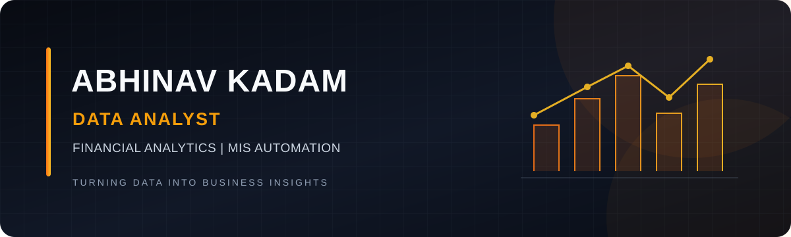
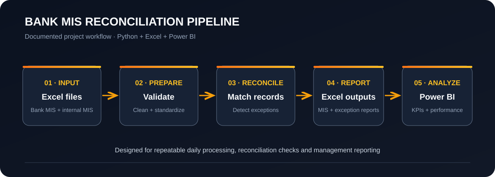

 

**DATA ANALYST · FINANCIAL ANALYTICS · MIS AUTOMATION**

*Turning operational data into clear, useful business insights.*

---

## About

I am a Data Science student building practical projects in **data analytics, business intelligence and reporting automation**. My work focuses on preparing reliable data, identifying patterns and exceptions, and presenting findings in a format that supports business decisions.

- **Domains of interest:** Banking, fintech, financial operations and business intelligence
- **Analytics:** SQL, Python, Excel, Power BI and DAX
- **Data work:** Cleaning, validation, reconciliation, exploratory analysis and KPI reporting
- **Currently developing:** Financial analytics and MIS automation skills

## Core toolkit

## Featured projects

Selected projects with real repository screenshots and documented outcomes.

### 01 · Bank Daily MIS Reconciliation Automation

**Python · Pandas · NumPy · OpenPyXL · Excel · Power BI · DAX**

Automates the processing and standardization of bank MIS files, matches internal and bank records, flags exceptions and generates structured Excel reports. The Power BI report supports reconciliation, payment-gap and business-performance analysis.

**Demonstration note:** The repository documents a test run using dummy banking data. Its README includes the sample reconciliation results and KPI definitions.

[Repository](https://github.com/abhianalyst/bank-daily-mis-automation) · [Business rules and KPIs](https://github.com/abhianalyst/bank-daily-mis-automation/tree/main/documentation)

---

### 02 · CrashLens NYC — Traffic Collision Analytics

**Python · Pandas · NumPy · Matplotlib · Seaborn · Power BI**

Analyzes New York City traffic collision records to identify accident patterns, contributing factors, time-based trends and geographic hotspots.

**Documented findings:** Brooklyn had the highest accident volume; afternoon hours showed a peak; driver inattention/distraction was the leading contributing factor in the analyzed dataset.

[Repository](https://github.com/abhianalyst/CrashLens-NYC) · [All dashboard pages](https://github.com/abhianalyst/CrashLens-NYC/tree/main/images/dashboard_images)

---

### 03 · Hospital Emergency Room Dashboard

**Power BI · Excel · DAX · Power Query**

An interactive healthcare operations dashboard for patient volume, waiting time, satisfaction, demographics and department referrals.

**Documented KPIs:** 9,216 patient visits · 35.26-minute average wait time · 4.99 average satisfaction score.

[Repository](https://github.com/abhianalyst/hospital-emergency-room-dashboard)

---

### 04 · Restaurant Data Analysis

**Python · Pandas · NumPy · Matplotlib · Seaborn · Plotly · Folium · Scikit-learn · NLTK**

An end-to-end analysis of restaurant data covering data preparation, cuisine trends, city-level comparisons, pricing, geographic patterns, clustering and sentiment analysis.

[Repository](https://github.com/abhianalyst/Restaurant-Data-Analysis) · [Visualizations](https://github.com/abhianalyst/Restaurant-Data-Analysis/tree/main/visuals)

---

### 05 · Spotify Listening Behavior Dashboard

**Power BI · DAX · Data Visualization**

Explores personal Spotify listening history to understand listening patterns, artist preferences, platform usage and trends over time.

**Dataset scale documented in the project:** 415,000+ listening minutes · 4,112 artists · 16.5K tracks.

[Repository](https://github.com/abhianalyst/Spotify-Dashboard)

---

## Skills in practice

| Focus | Tools and techniques |
|---|---|
| Data analysis | Python, SQL, Pandas, NumPy, EDA |
| BI and reporting | Power BI, DAX, Power Query, Excel |
| Financial operations | MIS reporting, reconciliation, exception analysis, KPI tracking |
| Visualization | Matplotlib, Seaborn, Plotly, dashboard design |
| Data science | Scikit-learn, clustering, NLP fundamentals |
| Development | PostgreSQL, SQLite, Django, Git, GitHub |

## Currently learning

- Advanced SQL for analytical problem-solving
- Financial statements, banking operations and financial KPIs
- Power BI modelling, DAX and Microsoft Fabric concepts
- Building robust, repeatable MIS reporting workflows

## GitHub activity

Statistics and activity visualizations are provided by external services and may occasionally be unavailable or delayed.

## Let's connect

I am interested in opportunities and learning projects related to **Data Analytics, MIS, Financial Analytics and Business Intelligence**.

**BUILD · ANALYZE · AUTOMATE · IMPROVE**

